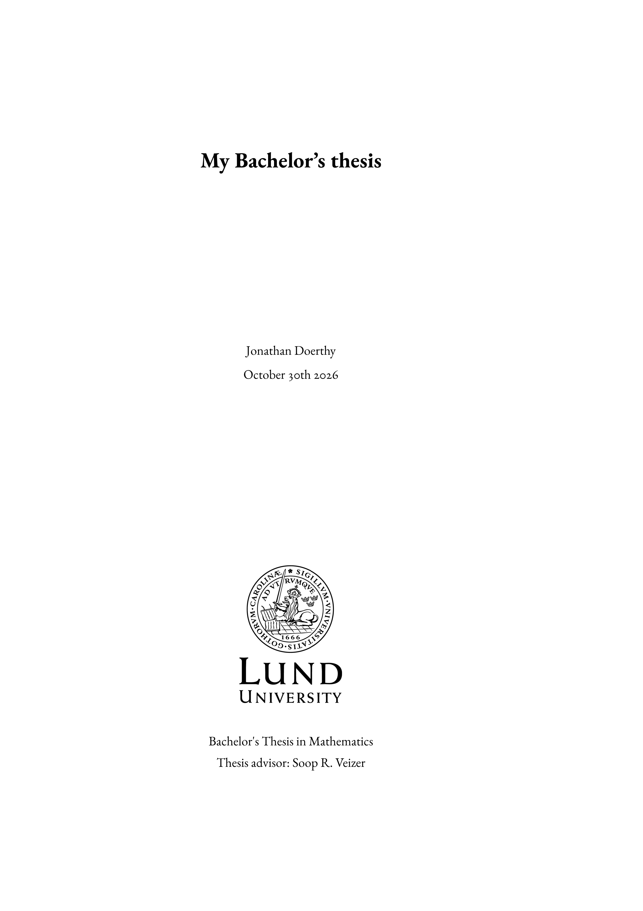
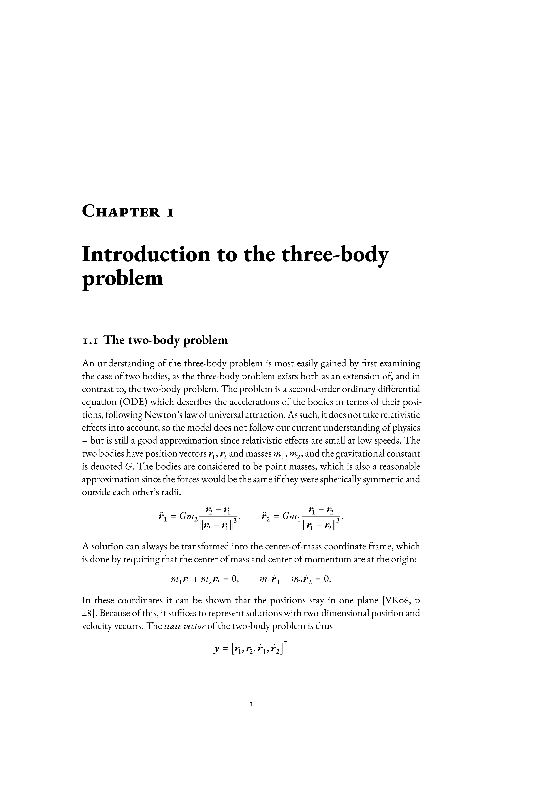
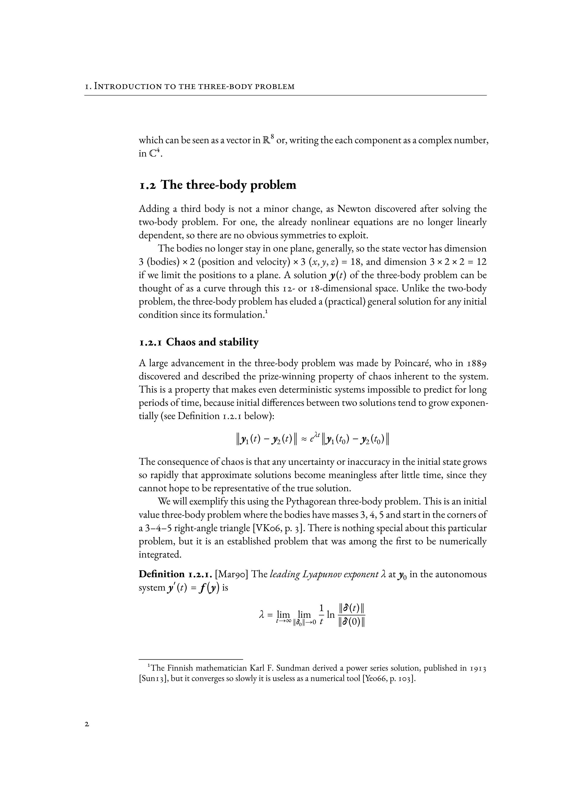
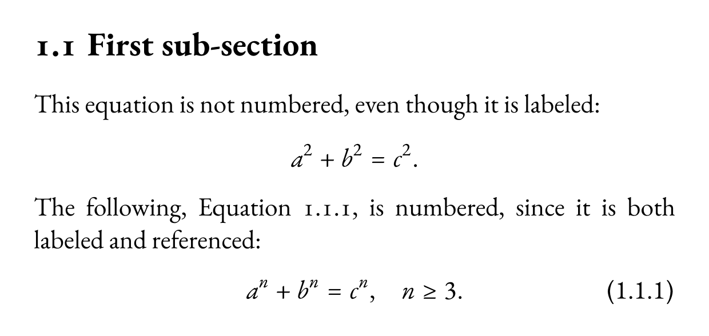
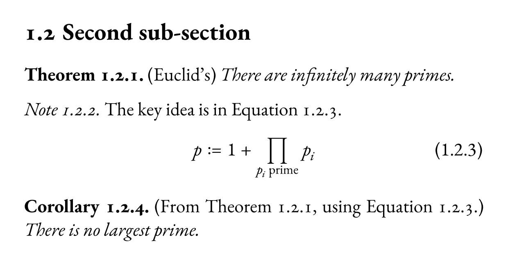
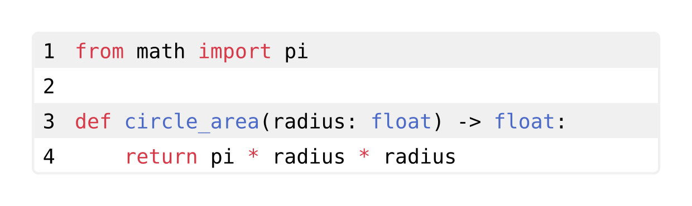
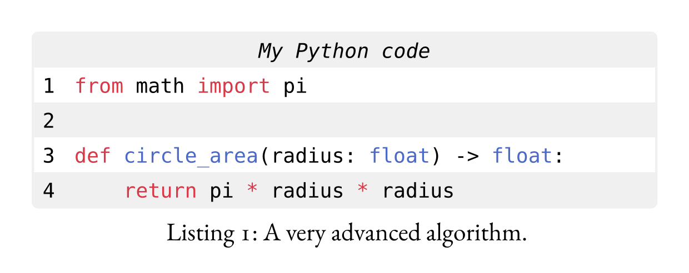
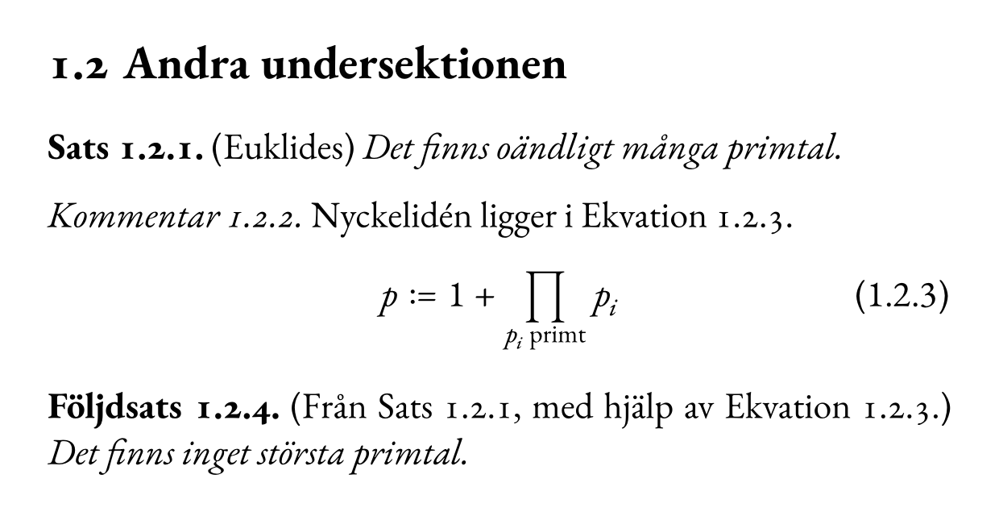

# kjell-thesis-LU



## Features
- Top-level headings are chapter titles.
- A title page can be created via the `#title-page(...)` function.
- The department's cover page, when received, can be applied easily using `#show: thesis-style.with(cover-page: path(...))`
- Convenience `#frontmatter[]` and `#appendices[]` functions.
- Swedish localization enabled using `#set text(lang: "sv")`.
- Equations are unnumbered by default, but numbers are added automatically when they are both labeled and referenced.
- Equations and theorem environments are numbered sequentially within subsections.
- Page headers include the current chapter name on verso pages, and the subsection name on recto pages (and are disabled on chapter starts).
- Page footers include the page number aligned outwards, and are centered on chapter starts.
- Code blocks are styled nicely by default using [codly](https://typst.app/universe/package/codly).
- Theorem, lemma, definition, proof environments etc using the [great-theorems](https://typst.app/universe/package/great-theorems) package.

## Wait, what's Typst?
Typst is a typesetting system. Depending on your use case and background, Typst can be thought of as either
- a more ergonomic and customizable alternative to LaTeX,
- a more powerful version of Markdown (which is what this README is written in), or
- a Python-like programming language that is specifically made for creating PDFs.

If you haven't used it before but would like to try, check out [typst.app](https://typst.app/), visit the [playground](https://typst.app/play/), go through the [tutorial](https://typst.app/docs/tutorial/), and then create an account to start editing online. Or, since Typst is open-source, [install the compiler](https://typst.app/open-source/) and start writing in your preferred editor.

## Getting started
Here's a starting point for a thesis:

```typst
#import "@preview/kjell-thesis-LU:0.1.0": *
#show: thesis-style

// All three fields needed for the title page
#set document(
  title: [My Bachelor's thesis],
  author: "Jonathan Doerthy",
  date: datetime.today(),
)

#title-page(
  level: "Bachelor's",
  subject: "Mathematics",
  advisor: "Soop R. Veizer",
)

#frontmatter[
  #abstract[
    ...
  ]
  #no-number[= Introduction
    ...
  ]
  #outline()
]

= First chapter
== First sub-section
...

#appendices[
  = Raw data
  ...

  #bibliography("my-sources.yaml") // Hayagriva bibliography format
  #bibliography("my-sources.bib")  // Or the more common BibTeX
]
```

This results in the front page shown above. Here are two full example pages:




## Requirements

To install the fonts needed (EB Garamond, Garamond-Math), follow the following steps:
1. Download [EB Garamond](https://github.com/octaviopardo/EBGaramond12/blob/master/fonts/variable/EBGaramond-Italic%5Bwght%5D.ttf).
2. Download [EB Garamond Italic](https://github.com/octaviopardo/EBGaramond12/blob/master/fonts/variable/EBGaramond-Italic%5Bwght%5D.ttf).
3. Download [Garamond-math](https://github.com/YuanshengZhao/Garamond-Math/blob/master/Garamond-Math.otf).
4. Install the fonts on your system (usually by opening them in your file explorer and pressing Install).

## Usage notes

The bibliography ([bibliography reference](https://typst.app/docs/reference/model/bibliography/)) can be given in either BibTeX or Hayagriva ([Hayagriva reference](https://github.com/typst/hayagriva/blob/main/docs/file-format.md)) format, or combined. To give multiple files of sources, use:
```typst
#bibliography(("sources1.bib", "sources2.yaml"))
```

Equations are numbered only when needed.
```typst
== First sub-section
This equation is not numbered, even though it is labeled:
$ a^2 + b^2 = c^2. $ <pythagoras>
The following, @fermat, is numbered, since it is both labeled and referenced:
$ a^n + b^n = c^n, quad n >= 3. $ <fermat>
```


Equations and theorems are numbered together, and both are numbered according to the sub-section they are in.
```typst
== Second sub-section
#theorem(title: [Euclid's])[
  There are infinitely many primes.
] <euclid>
#note[
  The central idea is the following.
  $ p := 1 + product_(p_i "prime") p_i $ <new-prime>
]
#corollary(title: [From @euclid, using @new-prime.])[
  There is no largest prime.
]
```


Including code from a file can be done in the usual Typst way:
```typst
#raw(read("my_code.py"), block: true, lang: "python")
```


You can optionally change the header or other style parameters using codly by writing `codly(header: [Some header], ...)` before that. For convenience, this is also packaged into the `input-code` function, which is here put inside a figure:
```typst
#figure(
  input-code(path("my_code.py"), header: [My Python code]),
  caption: [A very advanced algorithm.],
)
```


If the code block is too large to fit on a single page, you can allow it to break across pages by including ```#show figure: set block(breakable: true)``` before the figure.

Swedish localization can be enabled using `#set text(lang: "sv")`.
```typst
#set text(lang: "sv")
== Andra undersektionen
#theorem(title: [Euklides])[
  Det finns oändligt många primtal.
] <euclid>
#note[
  Nyckelidén ligger i @new-prime.
  $ p := 1 + product_(p_i "prime") p_i $ <new-prime>
]
#corollary(title: [Från @euclid, med hjälp av @new-prime.])[
  Det finns inget största primtal.
]
```


## Acknowledgements

Kjell (pronounced like "shell") Elfström made the LaTeX template this package is based on.
